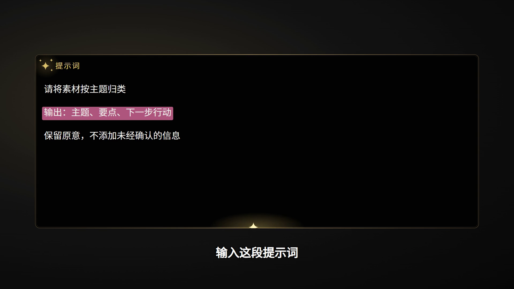

# 剪辑赋能skill

根据视频内容选择合适的章节和提示词讲解位置，自动改字并生成两种品牌组件；需要时把它们合成回视频，保留原声与总时长。

## 两个组件

| 鎏金章节标题 | 黑金提示词卡 |
| --- | --- |
| 鎏金文字、简洁入场与扫光、白色 cyt 印记 | 中文“提示词”、卷曲展开、粉色重点行 |
|  |  |

[2 秒标题样片](docs/previews/chapter-demo.mp4) · [2 秒提示词样片](docs/previews/prompt-demo.mp4)

## 安装

```bash
npx -y skills add cytxnyu/jianji-funeng-skill -g --all
```

仅安装到 Codex：

```bash
npx -y skills add cytxnyu/jianji-funeng-skill --skill jianji-funeng --agent codex -g -y
```

名称：**剪辑赋能skill**；技术调用标识：`jianji-funeng`。

## 直接这样用

```text
使用 $jianji-funeng 剪辑赋能skill，分析我提供的视频和 SRT。
只在真正的章节转折处添加鎏金标题；遇到实际讲解的提示词时，
添加黑金提示词卡并用粉色高亮关键约束。
文字必须对应口播或画面，不要每句话都加动画。
保留原声和总时长，输出成片、可编辑工程、插入时间表与验收结果。
```

也可以说：“用剪辑赋能skill 给这份字幕做组件选点”“只导出两个 2 秒换字样片”“把现有 Remotion 项目接入这两个组件”。

## 工作方式

1. 查看视频、字幕和候选时间点的画面。
2. Agent 根据语义写有原话证据的 `edit-plan.json`。
3. 脚本检查时间冲突、文字容量、阅读时长和引文。
4. 渲染独立组件；用户要求合成时，在原时间轴上替换相应画面，保留音轨。
5. 输出 MP4、核对帧、片段清单与可编辑源代码。

没有适合内容时可以不添加；仅有无时间轴稿件时先做内容映射，不编造插入秒数。语义判断由 Agent 执行，Python/Node 脚本不是独立的视频理解模型。

## 环境与格式

- Python 3.10+、FFmpeg／ffprobe、Node.js（版本范围见 package.json）、npm、Chrome／Remotion Headless Shell。
- 自带模板 16:9；其他画幅先重排再合成，不拉伸横版。
- 2 秒样片用于看样式。正式提示词卡按内容长度延长停留或拆分。
- 不自带语音识别；视频无字幕时使用当前 Agent 已有转写工具，或提供 SRT。
- 不覆盖源媒体，不自动上传素材。公开仓库只有 Skill、模板、字体授权文件与合成演示。

[Skill 入口](skills/jianji-funeng/SKILL.md) · [运行说明](skills/jianji-funeng/references/runtime.md) · [计划格式](skills/jianji-funeng/references/plan-schema.md)

## 字体与依赖

公开模板使用 Source Han Serif、Noto Sans SC、Libre Baskerville、Allura，随包保留各自 OFL 原文及下载地址、SHA-256。背景为程序生成，不含原视频截图、系统商业字体或个人项目素材。字体替换保留两种组件的配色、布局和动效结构。

[字体来源与授权](skills/jianji-funeng/assets/remotion-template/public/fonts/SOURCES.json) · [Remotion 项目及其许可](https://github.com/remotion-dev/remotion) · [Skills 安装工具文档](https://www.skills.sh/docs/cli)
